# תרשימי המערכת – Meridian Vote Tracker

> התרשימים כתובים ב-Mermaid. הם מוצגים אוטומטית ב-GitHub, ב-GitLab, ובתצוגה המקדימה של VS Code (צריך להתקין את התוסף *Markdown Preview Mermaid Support*).
> הטקסט בתוך התרשימים באנגלית, כדי שיתאים לשמות בקוד ובמסכים.

## תוכן

1. ארכיטקטורה: מה מדבר עם מה
2. קליטת קובץ CSV: רצף הפעולות
3. סיווג שורה: תרשים החלטה
4. החלטה על קונפליקט: שני אנליסטים במקביל
5. יצירת דירוג וחישוב ברקע
6. בונוס: חילוץ מדף סרוק
7. מחזורי חיים (State)
8. מודל הנתונים (ERD)

---

## 1. ארכיטקטורה

שלושה רכיבים רצים ב-Docker:
- פרונט Angular, שמוגש דרך nginx;
- API ב-ASP.NET Core;
- Workers ברקע, שרצים באותו תהליך כמו ה-API.

כל המשאבים של Azure מחוברים דרך זהות Entra, בלי מפתחות.

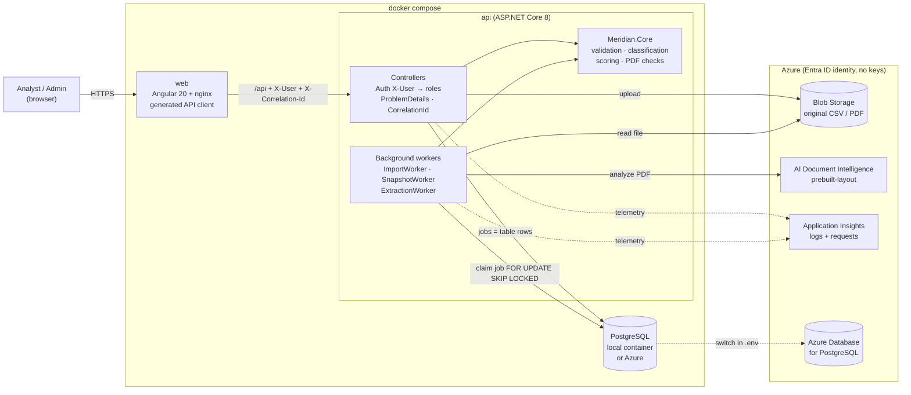

---

## 2. קליטת קובץ CSV (ING-01 עד ING-15)

הבקשה חוזרת מיד, והעיבוד ממשיך ב-worker. הוא עובד במנות של 250 הצבעות, וכל מנה היא טרנזקציה אחת.

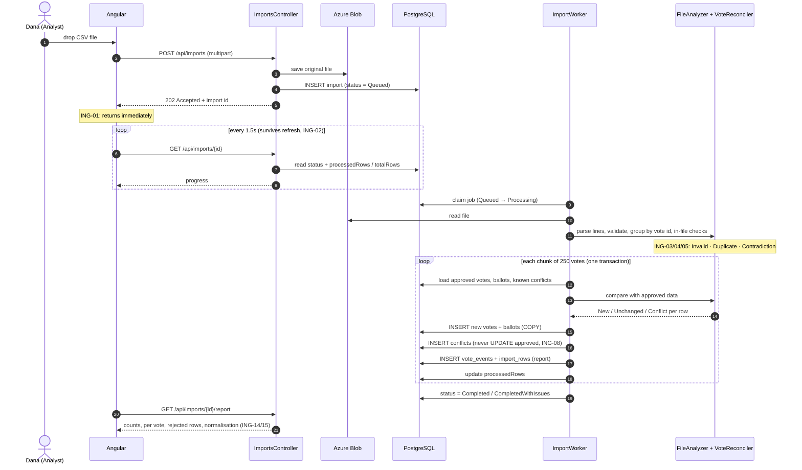

---

## 3. סיווג שורה (ING-06)

כל שורה מקבלת **בדיוק סיווג אחד**. שלוש הבדיקות הראשונות נעשות בתוך הקובץ. ההשוואה לנתון המאושר נעשית רק אחריהן.

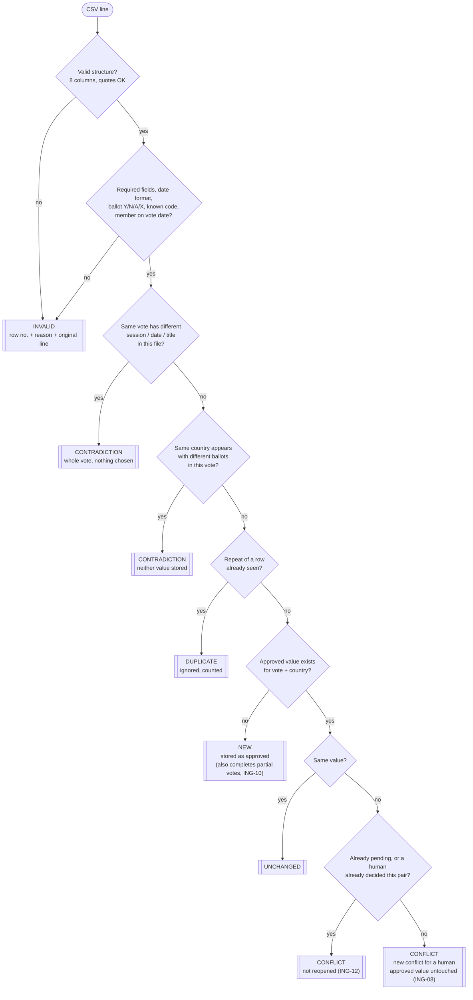

> פרטי ההצבעה (כותרת, תאריך, מושב) עוברים את אותה השוואה. שינוי בהם פותח **קונפליקט על ההצבעה עצמה** (CON-03).

---

## 4. החלטה על קונפליקט: שני אנליסטים במקביל (CON-04, CON-05)

ההחלטה היא `UPDATE` מותנה אחד. רק בקשה אחת יכולה "לנצח". השנייה מקבלת 409 עם המצב העדכני.

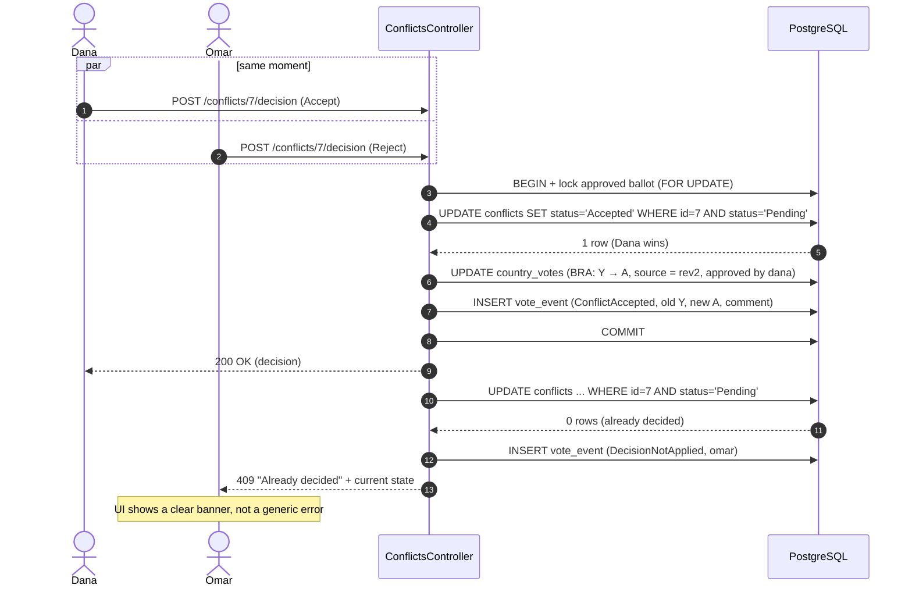

---

## 5. יצירת דירוג (SNP-01 עד SNP-05)

הקלט מוקפא ברגע היצירה, לכן דירוג שנשמר לא משתנה (SNP-04).

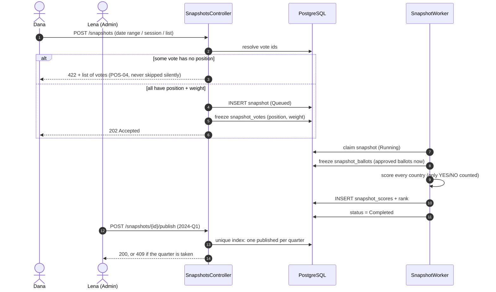

**חישוב הציון לכל מדינה:**

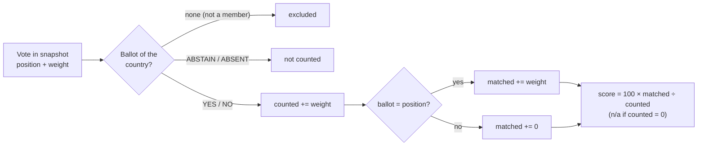

---

## 6. בונוס: חילוץ מדף סרוק (PDF-01 עד PDF-06)

פלט ה-AI הוא קלט לא אמין. הוא נבדק, עובר לבדיקה של אדם, ורק אחרי אישור נכנס לאותו מנגנון קליטה כמו CSV.

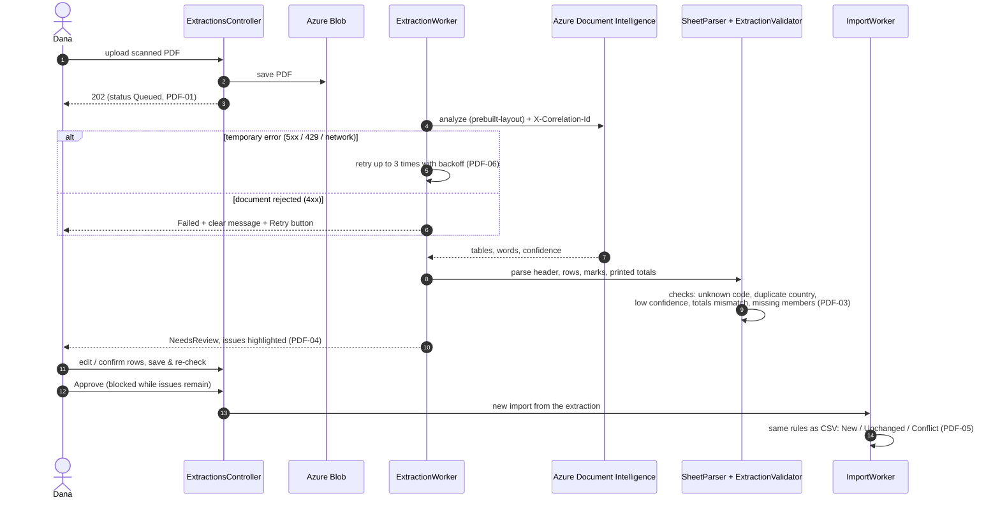

---

## 7. מחזורי חיים (State)

**קליטה:**
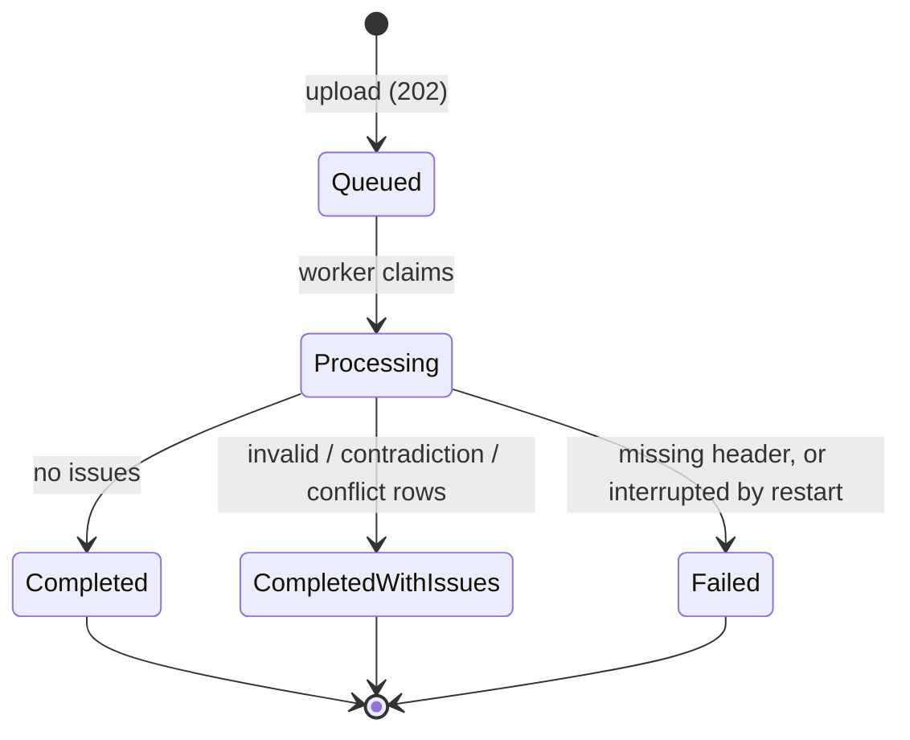

**קונפליקט:** החלטה היא סופית, וטריגר במסד חוסם שינוי שלה.
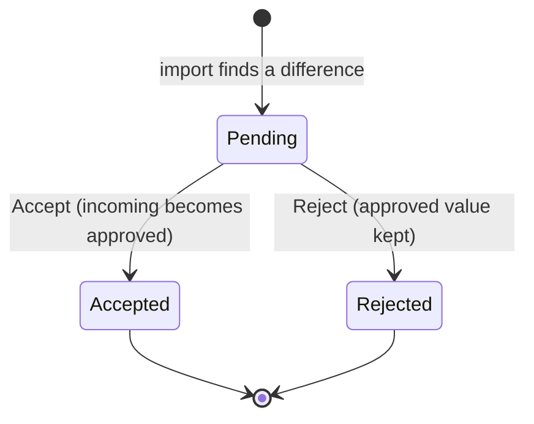

**דירוג:**
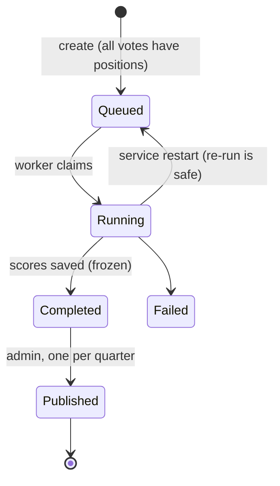

**חילוץ PDF:**
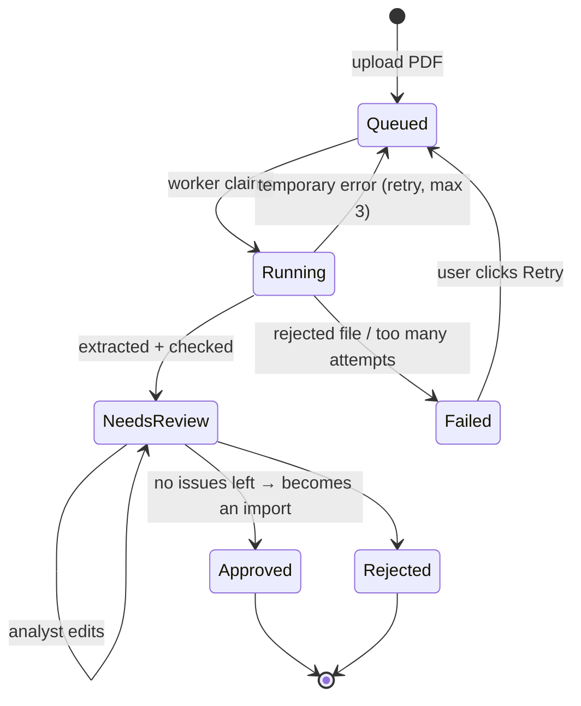

---

## 8. מודל הנתונים (ERD)

- **`country_votes`** מחזיקה את הערך **המאושר הנוכחי**.
- **`vote_events`** מחזיקה את **כל ההיסטוריה** (append-only).
- **טבלאות ה-`snapshot_*`** מחזיקות עותק **קפוא** של כל דירוג.

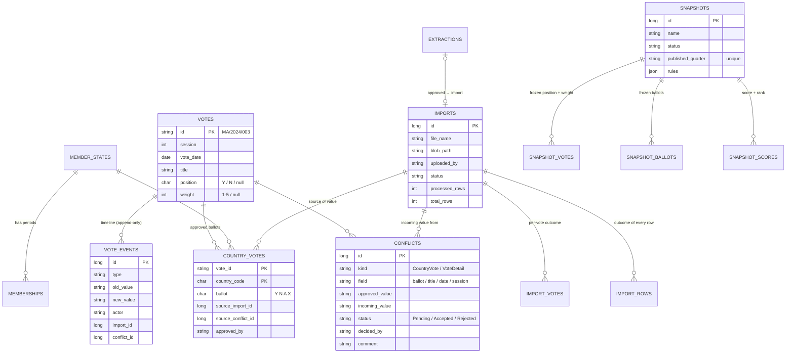

**שמירה על תקינות ברמת מסד הנתונים:**
- **check constraints:** ערך בחירה Y/N/A/X, משקל 1–5, פורמט רבעון.
- **unique index חלקי:** קונפליקט ממתין אחד לכל שינוי; דירוג מפורסם אחד לכל רבעון.
- **triggers:**
  - מונעים UPDATE ו-DELETE בהיסטוריה, בדוחות ובדירוגים;
  - מונעים מחיקת ערך מאושר;
  - מונעים שינוי של קונפליקט שהוכרע.
